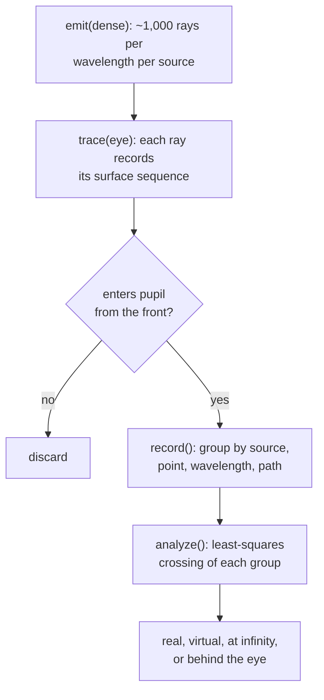

# Light Lab vision

Light Lab is a 2D optics sandbox that runs in the browser. You place light sources, mirrors, lenses, prisms, slits and an eye on a dark bench, and the page traces the light live. Every number it shows (focal length, fringe spacing, how much light survives a path) is computed from physics, so it can be checked against a textbook or a datasheet.

It exists because the browser tools that cover this today each do half the job. [Ray Optics Simulation](https://github.com/ricktu288/ray-optics) handles rays but not interference and looks dated. [Falstad's ripple tank](https://www.falstad.com/ripple/) and PhET's *Wave Interference* show waves but not measured values in real units. Light Lab puts accurate rays, accurate diffraction and an observer's eye in one modern sandbox.

A working prototype exists as two interactive screens. Its code, split by module, is in [`reference/`](../reference/README.md), and `node reference/checks/verify.mjs` checks its physics against known values.

## What the user can do

| Mode | The user | The page answers |
|---|---|---|
| Rays | Drags sources, mirrors, lenses, prisms, glass balls, blockers, detectors and rulers onto the bench, rotates them, edits them in an inspector | Where light goes, focal lengths, dispersion, spot size and power on a detector |
| Eye | Places an eye, aims it, sets pupil and field of view | What that eye sees, where each image appears, and how much light every path keeps |
| Waves | Picks single slit, double slit or grating, sets wavelength, slit width, separation, screen distance | The interference pattern, measured fringe positions, and how they compare with theory |

Scope is 2D only. There is no 3D view.

## How the physics works

All lengths are millimetres. All wavelengths are nanometres. JavaScript numbers are 64-bit floats, the same precision Rust's `f64` gives, so the engine stays in TypeScript. Move a function to Rust/WASM only when a profiler shows it is the bottleneck.

### Ray mode

| Piece | Model |
|---|---|
| Surfaces | Exact ray hits on line segments and circular arcs. Lenses are two arcs plus edge segments, so thick-lens effects and spherical aberration come out on their own |
| Refraction | Snell's law in vector form, with total internal reflection |
| Partial reflection | Fresnel equations, unpolarized average of s and p. Every glass hit splits into a transmitted and a reflected ray. A global switch turns this off for comparison |
| Dispersion | Sellmeier equation with datasheet coefficients for N-BK7, SF11 and fused silica. White light is 7 wavelengths from 400 to 670 nm |
| Ray budget | A ray stops below 0.2 % intensity on screen, or after 40 interactions |
| Drawing | Additive blending with per-ray alpha, one stroke per segment, so overlapping rays brighten the way light does |

### Eye mode

The eye works out what it sees by grouping the rays that actually enter its pupil. Each group is one image:

For each group the inspector shows the path in words ("2 refractions, 3 internal reflections"), the share of each ray's light that survives it, the share of the source that enters the pupil, and where the image sits. Virtual images are drawn on the bench with dashed lines traced back from the pupil.

The website version adds three things the prototype lacks:

1. **Fixed exposure.** The prototype scales brightness to the brightest path, which hides distance. The site uses a fixed exposure. A point source then stays the same size at any distance and only gets brighter as the eye approaches, and an extended object's apparent size follows `2·atan(h / 2d)`.
2. **A camera view with fisheye correction.** Rays land on a flat virtual sensor. A switch picks the projection:

    | Projection | Sensor position | Looks like |
    |---|---|---|
    | Rectilinear | `f·tan θ` | A normal photo, straight lines stay straight |
    | Equidistant | `f·θ` | Fisheye, the prototype's strip |
    | Stereographic | `2f·tan(θ/2)` | Between the two |

3. **A physical eye.** The eye becomes optics in the scene: cornea, lens and a curved retina from a standard model eye (Emsley reduced eye or Le Grand). Rays are traced to the retina, so blur, focus, accommodation, near point and depth of field come from the physics. A point source becomes a spot whose size depends on focus, never on distance. The retina strip is shown unrolled next to the rectilinear view.

### Wave mode

The pattern is an exact Huygens–Fresnel sum: wavelets from sample points across every slit, with 2D cylindrical amplitude `1/√r` and obliquity `(1 + cos θ)/2`, summed at each screen point. The Fraunhofer formula is drawn over it as a dashed curve.

Fringe positions are measured from the computed curve by finding the extreme inside a window around where theory puts it, refined with a parabola. The panel shows the measured value, the Fraunhofer value, the grating condition `d sin θ = λ` (or `a sin θ = λ`), the small-angle `λL/d`, and the Fresnel number `(W/2)² / λL` that says which regime applies.

A future ripple view would show waves spreading as a grid simulation (FDTD) on the GPU. It enlarges wavelengths to fit the grid, so it is for watching, not for measuring.

## What will bite

| Trap | Consequence | Rule |
|---|---|---|
| Ray self-intersection after a hit | Rays stick to the surface they just left | Ignore hits closer than `1e-6` mm |
| Fresnel splitting | Ray count explodes | Intensity floor plus depth cap, separate floors for drawing and for the eye pass |
| Brightness in 2D | Falls as `1/r`, not `1/r²` as in the real 3D world | Show the 2D value, offer a "3D equivalent" toggle |
| Double-slit fringes | Sit about 0.9 % inside `d sin θ = λ` because the single-slit envelope pulls them inward | Compare the sum with the Fraunhofer curve, explain the envelope pull in the panel. It is physics, not error |
| Near field | The Fraunhofer formula stops holding once the Fresnel number nears 1 | Say so in the panel, and keep the measurement from the sum |
| Large grating, wide view | Up to about 0.4 s per change in the prototype | Budget samples per slit times screen points, or move the sum to a worker |
| Object power | An object emits from several points | Normalize power per object, not per point, or totals exceed 100 % |

## Accuracy oracles

These values come from the prototype and are enforced by `reference/checks/verify.mjs`. The site's tests should keep all of them.

| Check | Expected |
|---|---|
| N-BK7 refractive index at 587.6 nm | 1.51680 |
| N-BK7 Abbe number | 64.17 |
| Thick lens, R 50, D 40, point source 100 mm before it | Paraxial image at x = −16.85 mm |
| Glass ball, straight-through path | Transmission `(1 − R)²` = 91.7 % with R = 4.21 % |
| Magnifier, object 40 mm before an f 60.2 mm thick lens | Virtual image near x = −101.4 mm |
| Single and double slit, far field | Huygens sum matches the Fraunhofer curve to 0.01 % |
| Single slit first minimum | Equals `L·tan(asin(λ/a))` |

Add these when the matching features land: the model eye's focal length is about 16.7 mm (60 dioptres), a point source's spot on the retina keeps its size as distance changes, and an object's apparent size equals `2·atan(h / 2d)`.

## Look and feel

The canvas is pure black, because this is an optical bench in a dark room and the light should be the only colour. Everything around it stays quiet.

| Token | Value | Use |
|---|---|---|
| Darkroom | `#000000` | Canvas, screen strip |
| Bench | `#191C22` | Panels, header |
| Rule | `#2C313B` | Borders, dividers |
| Chalk | `#E6E8EC` | Primary text |
| Graphite | `#A3AAB6` | Secondary text, labels |
| Sodium | `#FFB547` | Selection, handles, measured values. Taken from the 589 nm sodium D-line glass is rated at |

Type is Instrument Sans with tabular figures for every readout, never a monospace face. Sentence case everywhere, no all-caps labels.

The interface is a floating toolbar on the left, a floating inspector on the right, a zoom group and scale bar bottom left, and a status pill showing ray count and trace time. Objects carry live readouts beside them (focal length, spot width, what the eye sees). The header holds example scenes and the Rays / Waves switch. The prototype's two screens in `reference/ui-mockup/` are the visual reference.

Features the site adds beyond the prototype: undo and redo, saving, scenes shared as a link, a ⌘K command palette, snapping and alignment guides, editable endpoints, smooth zoom and pan, touch support, and a gallery of example scenes.

## Stack

| Layer | Choice | Why |
|---|---|---|
| Build | Vite + TypeScript | Types catch unit and vector mix-ups; zero setup |
| Interface | React + Tailwind + shadcn/ui | Panels, sliders, menus and dialogs without hand-building them |
| Canvas | p5 in instance mode inside one React component | Keeps p5 for drawing and pointer input |
| Engine | Plain TypeScript, no p5 or DOM imports | Testable in Node, reusable, can move to WASM function by function |
| Hosting | Vercel | Already set up on this account |

The engine is the core. It must not import anything from the interface or the renderer.

## Prior art and licences

| Project | Licence | What we may take |
|---|---|---|
| Ray Optics Simulation | Apache-2.0 | Ideas and features freely. Copied code keeps its licence notice. Never its name, logo or look |
| Falstad ripple tank | No licence in the repo | Ideas only, no code |
| PhET *Bending Light*, *Wave Interference* | No licence file in the repos; check PhET's licensing page | Ideas only until the licence is confirmed |
| Meep (FDTD) | GPL | Accuracy reference for wave results, no code |

## Build order and estimate

Solo and part-time. Phases 1 to 4 give a playable, accurate site in about 6 to 8 weeks. The full feature set is about 3 months.

| Phase | Contents | Time |
|---|---|---|
| 1 | Engine core and editor: sources, flat and curved mirrors, blockers, screens, drag and rotate | 2–3 weeks |
| 2 | Real optics: thick lenses, prisms, Fresnel lens, Fresnel equations, total internal reflection, dispersion | 2 weeks |
| 3 | Measurement: ruler, protractor, detectors with irradiance plots | 1 week |
| 4 | Waves: slits and gratings with measured values against theory | 1–2 weeks |
| 5 | Eye: path analysis, fixed exposure, camera projections, then the physical model eye | 2–3 weeks |
| 6 | Ripple view on the GPU (optional) | 2–3 weeks |

## Still to decide

- The product name. "Light Lab" is a working title.
